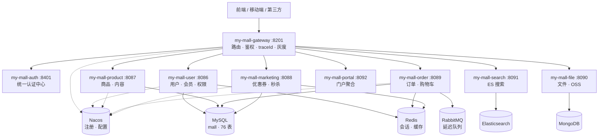

<div align="center">

# my-mall · 自研微服务电商系统

**基于 Spring Boot 3.5 + Spring Cloud 2025 + JDK 17 的电商微服务平台**

以「绞杀者模式」逐服务替换开源项目 [`mall-swarm`](https://github.com/macrozheng/mall-swarm)，
自研网关灰度接管 + HTTP 逐字段对比验收；迁移完成后系统性治理了 **20 项**继承自原系统的并发与一致性缺陷。

[](https://openjdk.org/projects/jdk/17/)
[](https://spring.io/projects/spring-boot)
[](https://spring.io/projects/spring-cloud)
[](https://nacos.io/)
[](https://sa-token.cc/)
[](https://www.mysql.com/)

**9** 个微服务 · **276** 个 REST 端点 · **76** 张数据表 · **20** 项缺陷治理

</div>

---

## 📖 目录

- [项目简介](#-项目简介)
- [为什么会有这个项目](#-为什么会有这个项目)
- [核心特性](#-核心特性)
- [系统架构](#-系统架构)
- [技术栈](#-技术栈)
- [功能清单](#-功能清单)
- [缺陷治理（20 项）](#-缺陷治理20-项)
- [快速开始](#-快速开始)
- [项目结构](#-项目结构)
- [关键设计](#-关键设计)
- [接口文档](#-接口文档)
- [路线图](#-路线图)
- [致谢](#-致谢)

---

## 🎯 项目简介

`my-mall` 是一套**功能完整的电商微服务后端**，覆盖商品、订单、会员、营销、搜索、支付等完整链路，
同时提供**管理端（Admin）**与**门户端（Portal）**两套 API。

与常见的"照着教程搭一遍"不同，本项目采用**可验证的重构方法论**：

| 特点 | 说明 |
|---|---|
| 🔬 **逐字节验收** | 每个新服务上线后，与老服务做 HTTP 响应**逐字段对比**，一致才扩大灰度 |
| 🎚️ **网关灰度** | 自研网关按路径灰度切换流量，出问题**秒级回滚**，老服务一行代码不改 |
| 🐛 **缺陷治理闭环** | 20 项继承缺陷 → **复现 → 修复 → 复验 → 存证 → 文档 → 提交**，每项都有实测证据 |
| 🧪 **数据说话** | 每一项判断（改 / 不改）都基于**实测数据**，而非理论推断 |
| 📚 **工程文档** | 16 份实测证据、复盘报告、专项技术文档 |

---

## 💡 为什么会有这个项目

### 起因

开源电商项目 [`mall-swarm`](https://github.com/macrozheng/mall-swarm) 是很多人的微服务入门教材，但它基于
**Spring Boot 2.x + Eureka + Spring Security**，技术栈已显陈旧，且长期迭代中积累了一批**并发与一致性缺陷**。

### 做法

与其"重写一遍"，不如把它当作一次**真实的遗留系统重构**演练：

```
① 用绞杀者模式（Strangler Fig）逐服务替换
   → 新服务新端口 + 新服务名，与老服务【并行运行】
   → 网关按路径灰度接管，逐字段对比通过才扩大范围

② 迁移完成后再做【系统性缺陷治理】
   → 把原系统继承的 20 项缺陷逐项复现、量化、决策、修复
   → 关键：不是所有"理论上的问题"都值得改
     20 项中有 7 项核实后确认无需修改（其中 2 项照抄建议反而会引入问题）
```

### 收获

这个项目的价值不只是"能跑"，而在于**完整的工程过程**：

- ✅ **怎么做可验证的重构** —— 不是"我觉得对"，而是"逐字段对比通过"
- ✅ **怎么判断一个缺陷值不值得修** —— 收益 / 成本 / 是否引入新问题
- ✅ **怎么在遗留系统里安全地改动** —— 有证据、可回滚、不破坏契约
- ✅ **怎么诚实地记录局限** —— 做不到的部分明确写出，而非宣称"彻底解决"

---

## ✨ 核心特性

### 🏗️ 架构能力

- **9 个微服务**：业务域清晰划分，独立部署、独立扩缩容
- **自研网关**：基于 WebFlux 的路由 + 接口级鉴权 + 链路追踪 + 灰度接管
- **统一认证中心**：按 `clientId` 分发管理端/门户端登录，Sa-Token + JWT 无状态鉴权
- **服务治理**：Nacos 注册发现 + 配置中心（每服务独立 dataId）
- **服务间调用**：各服务内 `@FeignClient` 直连（当前仅 auth → user / portal 两条链路）；契约模块 `my-mall-api` 已预留骨架，尚未启用

### 🔒 数据一致性

- **原子条件更新**：**11 处**库存/状态/计数的并发安全实现（不依赖分布式锁，**天然分布式安全**）
- **幂等设计**：下单、支付回调、订单取消三条链路全幂等
- **对账机制**：5 条业务不变量 + 每日定时任务，**主动发现**数据不一致
- **分布式事务**：不引入 2PC，用「原子更新 + 重试 + 对账」替代

### 💰 业务完整度

- **商品**：SPU/SKU 多规格、多级分类、品牌、属性、阶梯价、满减、单品促销
- **订单**：购物车、确认单、下单、支付、取消、超时关闭、退货、发货、收货
- **营销**：优惠券（多类型/限领）、秒杀活动与场次、首页运营位
- **会员**：注册登录、积分、成长值、收货地址、优惠券
- **支付**：支付宝沙箱（下单 / 回调 / 查询 / 退款）
- **搜索**：Elasticsearch 商品搜索、分类/品牌/属性聚合、相关推荐

---

## 🏛️ 系统架构



### 服务清单

| 服务 | 端口 | 职责 | 规模 |
|---|---|---|---|
| `my-mall-gateway` | 8201 | 自研网关：路由、接口级鉴权、traceId、灰度 | — |
| `my-mall-auth` | 8401 | 统一认证中心（按 clientId 分发） | 1 Controller |
| `my-mall-user` | 8086 | 用户、会员、权限、角色、菜单 | 6 Controller / 47 端点 |
| `my-mall-product` | 8087 | 商品、SKU、分类、品牌、属性、内容 | 8 Controller / 52 端点 |
| `my-mall-marketing` | 8088 | 优惠券、秒杀、首页运营位 | 10 Controller / 60 端点 |
| `my-mall-order` | 8089 | 订单、购物车、退货、发货 | 5 Controller / 26 端点 |
| `my-mall-search` | 8091 | Elasticsearch 商品搜索 | 1 Controller / 9 端点 |
| `my-mall-portal` | 8092 | 门户聚合（会员侧全链路） | 13 Controller / 78 端点 |
| `my-mall-file` | 8090 | 文件上传（OSS 直传签名 + 回调） | 1 Controller / 3 端点 |

**公共模块**

| 模块 | 说明 |
|---|---|
| `my-mall-common-core` | 契约层：`CommonResult` / `CommonPage` / 错误码 / 业务异常 |
| `my-mall-common-web` | Servlet 栈公共件（全局异常 / traceId / OpenAPI） |
| `my-mall-common-redis` | Redis 配置（与老项目序列化契约逐项对齐） |
| `my-mall-api` | 服务间契约（**骨架，未启用**）：预留 DTO + Feign 接口，当前服务间调用仍为各服务内 `@FeignClient` 直连 |

---

## 🛠️ 技术栈

### 核心框架

| 技术 | 版本 | 说明 |
|---|---|---|
| **JDK** | **17** | LTS |
| **Spring Boot** | **3.5.14** | 底层框架 |
| **Spring Cloud** | **2025.0.2** | 微服务套件 |
| **Spring Cloud Alibaba** | **2025.0.0.0** | Nacos 集成 |
| **Nacos** | **3.0.3** | 注册中心 + 配置中心 |

### 数据与存储

| 技术 | 版本 | 用途 |
|---|---|---|
| **MySQL** | 8.x | 主数据库（76 张表） |
| **MyBatis** | 3.0.4 | ORM |
| **MyBatis Generator** | 1.4.2 | 代码生成 |
| **PageHelper** | 2.1.1 | 分页 |
| **Druid** | 1.2.24 | 连接池 + 监控 |
| **Redis** | — | 会话、缓存、计数器 |
| **Elasticsearch** | — | 商品搜索与聚合 |
| **MongoDB** | — | 商品浏览记录等文档数据 |

### 认证与安全

| 技术 | 版本 | 说明 |
|---|---|---|
| **Sa-Token** | **1.42.0** | 认证鉴权（JWT 简单模式 + Redis 会话） |
| 双 StpLogic | — | 管理端 / 会员端登录态隔离（`adminLogin` / `memberLogin`） |

### 中间件与集成

| 技术 | 用途 |
|---|---|
| **RabbitMQ** | 延迟队列（订单超时取消，TTL + 死信） |
| **Feign** | 服务间调用 |
| **Spring WebFlux** | 网关（响应式栈） |
| **阿里云 OSS** | 文件存储（前端直传 + 服务端签名） |
| **支付宝 SDK** | 4.40.630.ALL（沙箱环境） |

### 工具与文档

| 技术 | 版本 | 说明 |
|---|---|---|
| **springdoc-openapi** | 2.8.17 | OpenAPI 3 文档 |
| **Knife4j** | 4.5.0 | 增强 UI（网关聚合） |
| **Lombok** | 1.18.34 | 样板代码消除 |
| **Hutool** | — | 工具集 |

---

## 📦 功能清单

<details>
<summary><b>🛍️ 商品域（my-mall-product，52 端点）</b></summary>

- **商品管理**：SPU 创建、编辑、上下架、审核、批量操作
- **SKU 多规格**：按属性组合生成 SKU、独立库存/价格/图片
- **分类管理**：多级分类树、分类与属性关联
- **品牌管理**：品牌 CRUD、品牌与分类关联
- **属性管理**：属性分类、属性、属性值（规格 / 参数）
- **促销配置**：单品促销、阶梯折扣、满减规则
- **内容管理（CMS）**：话题、专题、帮助文档、优选专区

</details>

<details>
<summary><b>📦 订单域（my-mall-order，26 端点）</b></summary>

- **购物车**：加购、改数量、删除、清空（**服务端定价**）
- **订单主流程**：确认单 → 下单 → 支付 → 发货 → 收货 → 完成
- **库存管理**：下单锁定、支付扣减、取消释放（**三步曲模型**）
- **订单取消**：用户主动取消 + 超时自动关闭（MQ 延迟队列 + 定时兜底）
- **退货流程**：申请退货、审核、退款
- **发货管理**：物流公司、运单号
- **订单设置**：超时时长、自动确认收货天数

</details>

<details>
<summary><b>🎁 营销域（my-mall-marketing，60 端点）</b></summary>

- **优惠券**：满减 / 折扣券、指定分类 / 商品、每人限领、领取与核销
- **秒杀**：活动、场次、时段、商品关联
- **首页运营**：轮播广告、品牌推荐、新品推荐、人气推荐、专题推荐

</details>

<details>
<summary><b>👤 用户域（my-mall-user，47 端点）</b></summary>

- **会员**：注册、登录、信息维护、积分、成长值、等级
- **收货地址**：CRUD、默认地址
- **后台权限 RBAC**：管理员、角色、菜单、权限、资源
- **登录日志**：管理端 + 会员端

</details>

<details>
<summary><b>🏬 门户域（my-mall-portal，78 端点）</b></summary>

- **会员前台**：登录注册、个人中心、地址管理
- **购物链路**：购物车、确认单、下单、支付、取消
- **订单中心**：列表、详情、确认收货、删除
- **营销前台**：领券、我的优惠券、秒杀
- **支付宝集成**：支付下单、异步回调、主动查询

</details>

<details>
<summary><b>🔍 搜索域（my-mall-search，9 端点）</b></summary>

- 商品关键词搜索、分类 / 品牌 / 属性聚合筛选
- 排序（价格 / 销量 / 新品）、分页
- 相关商品推荐、搜索建议

</details>

<details>
<summary><b>📁 文件服务（my-mall-file，3 端点）</b></summary>

- OSS 前端直传签名（Policy 生成）
- 上传回调校验与入库

</details>

---

## 🐛 缺陷治理（20 项）

迁移完成后，针对**原系统继承的并发与一致性缺陷**做系统性治理，共 **20 项**。

### 治理结果

| 结论 | 项数 | 说明 |
|---|---|---|
| 🔧 **完整修复** | **10** | 有代码改动 + 实测复现 + 复验通过 |
| ✅ **核实后无需改** | **7** | 避免过度修改（含 2 项"照抄建议反而会引入问题"） |
| 📝 **主体完成（残留已登记）** | **3** | 有明确前置依赖（属拆库阶段） |

### 完整修复（10 项，均有实测证据）

| # | 问题 | 影响 | 实测数据 |
|---|---|---|---|
| **#9** | 锁库存丢失更新 | 🔴 超卖 | 修复前 9 并发抢 5 件 → **成功 9 单**；修复后 → **5 单** |
| **#14** | 下单幂等 | 🔴 重复下单 | 修复前 2 并发 → **2 张订单**；修复后 → **1 张** |
| **#7** | 优惠券超发 | 🔴 超卖 | 修复前 8 并发抢 2 张 → **发出 3 张**；修复后 → **2 张** |
| **#8** | 每人限领绕过 | 🟠 超领 | 修复前 8 并发同会员 → **领到 6 张**；修复后 → **1 张** |
| **#13** | 积分重复扣减 + `use_integration` 不落库 | 🔴 丢失更新 + **取消订单永不退积分** | 并发两笔 → 积分 **700**（丢 300）→ 修复后 **400**；字段恒 `NULL` → 修复后正确退还 |
| **#3** | 促销过期仍生效 | 🟠 资损 | 3 个商品过期（最久 **6.4 年**）仍给优惠 → 修复后降级为"无优惠" |
| **#4** | 满减分摊精度 | 🟠 资损 | 承诺减 120 实减 **118.80**（多付 1.20）→ 修复后**精确 120.00** |
| **#10** | 无明细订单永不取消 | 🟠 订单永久挂起 | 订单停 **1253 天** → 修复后 **65 秒内**自动关闭 |
| **#17** | 取消接口"假成功" | 🟠 语义错误 | 返回"操作成功"但**什么都没做** → 已删除该接口 |
| **#20** | 加购不补全价格 | 🔴 NPE 500 + **可资损** | 漏传 price → **下单 500**；传 `0.01` → **可按错价下单** → 修复为**服务端定价** |

### 主体完成（3 项，残留子项已登记）

| # | 已完成部分 | 残留子项（原因） |
|---|---|---|
| **#12** | 数据对账机制（5 条不变量 + 每日定时任务，**主动发现**数据不一致） | 跨域直写改 Feign + Outbox（属**拆库阶段**，同库时本地事务仍可靠） |
| **#15** | A：取消幂等（`updateOrderStatusByIdIfPending` + 下界保护）—— `lock_stock` 由 **-24** 归零 | B：取消/退款失败无重试（需状态机 + 补偿框架） |
| **#16** | 支付回调幂等 + 金额校验 + `query` 判空 —— 串行连调 3 次 `lock_stock` 变 **-1/-2** → 修复后**完全无变化** | 越权校验（`paySuccess` 未校验归属，**按决策不做**） |

### 核实后确认无需修改（7 项）

> **这是本项目最有价值的工程决策之一** —— 其中 **2 项若照抄文档建议，反而会引入问题**。

| # | 表面问题 | 核实结论 |
|---|---|---|
| **#1** | 库存超卖风险 | 已被 #9 覆盖；**建议的 SQL 会破坏库存三步曲模型** ⚠️ |
| **#2** | 并发价格变化 | 已满足（下单重查 DB + **入参根本没有 price 字段**） |
| **#5** | 多表 JOIN 笛卡尔积 | 实测 **0.4~0.9ms** 已最优；**建议的"拆查询"会让性能变差** ⚠️ |
| **#6** | 促销不能叠加 | **设计如此**（单字段 + 单分支，物理上无法叠加） |
| **#11** | 延迟队列队头阻塞 | **前提不成立**（所有消息 TTL 相同）；提高频率反使 DB 开销 ×5 |
| **#18** | 订单号号段浪费 | 真实但**极小**（每次失败 1 个号）；改 DB 序列会引入**全局热点行锁** |
| **#19** | 热点库存行锁竞争 | 机制真实但当前无影响；**与 #9 一体两面**（加锁必然串行化） |

### 三个"文档未提到"的隐藏缺陷

> **① `use_integration` 不落库 → 取消订单永不退积分**
>
> 赋值被写在 `orderMapper.insert()` **之后**，导致该字段永远不写入数据库。
> 连锁影响：`cancelOrder` 里 `if (getUseIntegration() != null)` **恒为 false** → **用户资损**。

> **② 加购可传任意价格 → 连支付金额校验都拦不住**
>
> 前端可传 `price=0.01` 直接落库。这个缺口**在支付层无法发现** ——
> 因为订单金额就是 0.01、支付回调也是 0.01，**两边一致，校验通过**。

> **③ 无明细订单永不被兜底取消**
>
> 兜底 SQL 带 `EXISTS(明细)` 条件 → 无明细订单被永久排除。
> 实测库中有一张订单**停了 1253 天（3.4 年）**未被关闭。

### 方法论沉淀

修复手法沉淀为一个可复用的范式 —— **原子条件更新**：

```sql
UPDATE <表> SET <字段> = <字段> ± ?
WHERE <主键> = ?
  AND <前置条件>          -- ★ 把"检查"并入 SQL
```

调用方按**影响行数**裁决成败。该范式在 **11 处**复用，且因为**依赖 InnoDB 行锁（数据库层）而非 JVM 锁**，
**天然分布式安全** —— 拆库后依然有效，无需引入分布式锁。

> 📄 完整的 20 项治理记录（问题现象 / 根因 / 实测数据 / 方案对比 / 验证结果）
> 见 **[docs/后期优化文档.md](docs/后期优化文档.md)**；
> 对应的**原始实测输出**（请求响应、库内数据前后对照、JMeter 结果文件）见
> **[stress/result/](stress/result/)**，每个文件标注了它对应哪一项缺陷。

---

## 🚀 快速开始

### 环境要求

| 组件 | 版本 | 必需 |
|---|---|---|
| JDK | 17+ | ✅ |
| Maven | 3.8+ | ✅ |
| MySQL | 8.0+ | ✅ |
| Redis | 5.0+ | ✅ |
| Nacos | 2.x / 3.x | ✅ |
| RabbitMQ | 3.x+ | 推荐（订单超时取消） |
| Elasticsearch | 7.x+ | 可选（搜索功能） |
| MongoDB | 4.x+ | 可选（浏览记录） |

### 1. 初始化数据库

数据库表结构沿用 `mall-swarm` 的 `mall.sql`（本项目迁移期**与原项目共用同一个 `mall` 库**，
稳定后再按域拆库）：

```bash
mysql -uroot -p -e "CREATE DATABASE mall DEFAULT CHARACTER SET utf8mb4 COLLATE utf8mb4_general_ci;"
mysql -uroot -p mall < mall.sql      # mall.sql 来自 mall-swarm 项目
```

### 2. 启动 Nacos

```bash
sh startup.sh -m standalone      # Linux / macOS
startup.cmd -m standalone         # Windows
```

### 3. 导入 Nacos 配置

将 `NacosConfig/` 下各服务的配置按 dataId 导入 Nacos（每服务一个：`my-mall-<svc>-dev.yaml`）：

```
NacosConfig/
├── gateway/   application.yml
├── auth/      application.yml
├── user/      application.yml
├── product/   application.yml
├── marketing/ application.yml
├── order/     application.yml
├── search/    application.yml
├── portal/    application.yml
└── file/      application.yml
```

> 各服务的 `application.yml` 通过 `spring.config.import: optional:nacos:...` 拉取远端配置。

### 4. 编译

```bash
mvn clean install -DskipTests
```

### 5. 启动服务

```bash
# ① 基础服务
mvn -pl my-mall-gateway spring-boot:run     # 8201
mvn -pl my-mall-auth    spring-boot:run     # 8401

# ② 业务服务（可并行）
mvn -pl my-mall-user      spring-boot:run   # 8086
mvn -pl my-mall-product   spring-boot:run   # 8087
mvn -pl my-mall-marketing spring-boot:run   # 8088
mvn -pl my-mall-order     spring-boot:run   # 8089
mvn -pl my-mall-file      spring-boot:run   # 8090
mvn -pl my-mall-search    spring-boot:run   # 8091
mvn -pl my-mall-portal    spring-boot:run   # 8092
```

### 6. 验证

```bash
# 管理端登录
curl -X POST http://localhost:8201/mall-admin/admin/login \
     -H "Content-Type: application/json" \
     -d '{"username":"test","password":"123456"}'

# 会员端登录
curl -X POST "http://localhost:8201/mall-portal/sso/login?username=ljTest&password=123456"
```

接口文档（Knife4j 聚合）：<http://localhost:8201/doc.html>

---

## 📂 项目结构

```
my-mall/
├── my-mall-common/              # 公共模块
│   ├── my-mall-common-core/     #   契约层：CommonResult / CommonPage / 错误码 / 业务异常
│   ├── my-mall-common-web/      #   Servlet 公共件：全局异常 / traceId / OpenAPI
│   └── my-mall-common-redis/    #   Redis 配置（与老项目序列化契约对齐）
│
├── my-mall-api/                 # 服务间契约（骨架，未启用）
│
├── my-mall-gateway/             # 🚪 自研网关（WebFlux，8201）
├── my-mall-auth/                # 🔐 统一认证中心（8401）
├── my-mall-user/                # 👤 用户与权限（8086）
├── my-mall-product/             # 🛍️ 商品与内容（8087）
├── my-mall-marketing/           # 🎁 营销域（8088）
├── my-mall-order/               # 📦 订单域（8089）
├── my-mall-search/              # 🔍 搜索域（8091）
├── my-mall-portal/              # 🏬 门户聚合（8092）
├── my-mall-file/                # 📁 文件服务（8090）
│
├── NacosConfig/                 # Nacos 配置导入源（每服务一个目录）
├── stress/result/               # 压测与验证证据（原始实测输出，按缺陷编号对照）
└── docs/
    ├── 后期优化文档.md            # ★ 20 项缺陷治理完整记录
    ├── ai/                      # 各模块架构与接口说明
    └── notes/                   # 专项技术文档
        ├── 秒杀业务的实现.md
        └── 数据库拆分方案.md
```

---

## 🔑 关键设计

### 1. 库存三步曲模型

```
下单（未付款）  →  stock 不变，lock_stock +1   「占住，不扣」
支付成功        →  stock -1，lock_stock -1     「真扣」
取消 / 超时      →  stock 不变，lock_stock -1   「释放」
```

> **为什么不用"下单即扣 stock"**：若下单就扣，取消时就要加回，模型更复杂且与老项目行为不一致。
> 三步曲让「可售库存 = `stock - lock_stock`」成为一条贯穿始终的不变量。

### 2. 原子条件更新（并发安全的统一手法）

```sql
-- 锁库存（防超卖）
UPDATE pms_sku_stock SET lock_stock = lock_stock + #{n}
WHERE id = #{skuId} AND stock - lock_stock >= #{n}

-- 券计数（防超发）
UPDATE sms_coupon SET count = count - 1, receive_count = receive_count + 1
WHERE id = #{id} AND count > 0

-- 积分扣减（防丢失更新 + 防负数）
UPDATE ums_member SET integration = integration - #{n}
WHERE id = #{id} AND integration >= #{n}

-- 订单状态裁决（幂等）
UPDATE oms_order SET status = 4 WHERE id = #{id} AND status = 0
```

**核心思想**：把「检查」写进 SQL 的 `WHERE`，让数据库在**同一条语句内原子地完成"检查 + 修改"**，
用**影响行数**裁决成败。

**原理**：依赖 **InnoDB 行级排他锁** 把"读最新值 → 计算 → 写回"串行化 ——
这是**悲观锁**思路，而非乐观锁（乐观锁靠版本号事后比对，不加锁）。

### 3. 数据对账（"发现"能力）

```
不变量 I1：lock_stock == 待付款订单明细合计
不变量 I2：无负库存 / 负锁定
不变量 I3：lock_stock <= stock
不变量 I4：status ∈ (1,2,3) 必须有 payment_time
不变量 I5：无孤儿锁定（lock_stock 增加但无订单引用）
```

每日凌晨定时任务扫描，发现不一致则 `log.error` 告警（**不自动修复**，需人工确认）。

> **为什么需要它**：丢失更新发生时，**两个事务都成功提交、无异常、无回滚 —— 一行 warning 都不会有**。
> 只有"不变量被打破"能被表达出来。**日志是"点的、被动的"；对账是"面的、主动的"。**

### 4. 网关灰度接管（迁移期）

```
老服务（mall-swarm）              新服务（my-mall）
 8080 / 8081 / 8085       ⟷        8086 ~ 8092
         │                              │
         └────── 自研网关 8201 ─────────┘
                     │
               按路径灰度切换
          （逐字段对比通过 → 扩大范围）
```

**迁移期**：网关按路径灰度 → 对比通过 → 逐步全量 → 老服务注销。
**过程中**：老项目**一行代码不改**，作为参考实现与验收基座。

> 迁移已完成，老服务于 **2026-10-16** 注销（见 commit `ecb5d1c`）；本项目包名已私有化为 `com.mymall.*`。

### 5. 服务端定价（永不信任客户端输入）

```java
// ❌ 反模式：直接落库前端传入的价格
public CommonResult add(@RequestBody OmsCartItem cartItem)

// ✅ 正确：按 skuId 回查，服务端定价
PmsSkuStock sku = skuStockMapper.selectByPrimaryKey(cartItem.getProductSkuId());
cartItem.setPrice(sku.getPrice());              // 覆盖前端传的任何价格
cartItem.setProductId(sku.getProductId());      // 补全
```

> **价格是服务端资产，客户端只能"看"不能"说"。**

---

## 📘 接口文档

服务启动后访问 **Knife4j 聚合文档**：

| 服务 | 文档地址 |
|---|---|
| 网关（聚合全部） | <http://localhost:8201/doc.html> |
| 用户 | <http://localhost:8086/doc.html> |
| 商品 | <http://localhost:8087/doc.html> |
| 营销 | <http://localhost:8088/doc.html> |
| 订单 | <http://localhost:8089/doc.html> |
| 门户 | <http://localhost:8092/doc.html> |

### 返回结构约定

```json
{
  "code": 200,
  "message": "操作成功",
  "data": {}
}
```

分页结构：

```json
{
  "pageNum": 1,
  "pageSize": 5,
  "total": 100,
  "totalPage": 20,
  "list": []
}
```

---

## 🗺️ 路线图

### ✅ 已完成

- [x] 9 个微服务拆分与迁移（绞杀者模式 + 网关灰度 + 逐字段验收）
- [x] 自研网关（路由 / 接口级鉴权 / traceId）
- [x] 统一认证中心（管理端 + 会员端双 StpLogic）
- [x] Nacos 注册发现 + 配置中心全量接入
- [x] **20 项缺陷治理**（10 修复 / 7 核实不改 / 3 主体完成）
- [x] 数据对账机制（5 条不变量 + 定时任务）
- [x] 老服务正式注销 + 包名私有化

### 🚧 下一步

- [ ] **跨域访问消除** —— 拆库前置（portal 直连 5 个域 / 30 张表 → 改 Feign）
- [ ] 数据库拆分（详见 [拆库方案](docs/notes/数据库拆分方案.md)）
- [ ] 本地消息表（Outbox）可靠投递
- [ ] 分布式链路追踪（SkyWalking / Zipkin）
- [ ] 容器化部署（Docker Compose / K8s）
- [ ] 单元测试与集成测试覆盖率提升

---

## 🙏 致谢

- 本项目对标并参考了 [`mall-swarm`](https://github.com/macrozheng/mall-swarm)（[@macrozheng](https://github.com/macrozheng)），
  在此致谢原作者的开源贡献。原项目作为**参考实现与验收基座**，本项目在迁移过程中**未修改其任何代码**。
- 感谢 [Sa-Token](https://sa-token.cc/)、[Nacos](https://nacos.io/)、[MyBatis](https://mybatis.org/)、
  [Knife4j](https://doc.xiaominfo.com/) 等优秀开源项目。

---

## 📄 说明

本项目为**学习与技术验证**用途。项目中的商品图片、品牌名称等素材仅用于技术演示，版权归各自所有者。

---

<div align="center">

**如果这个项目对你有帮助，欢迎点一个 ⭐ Star**

</div>
